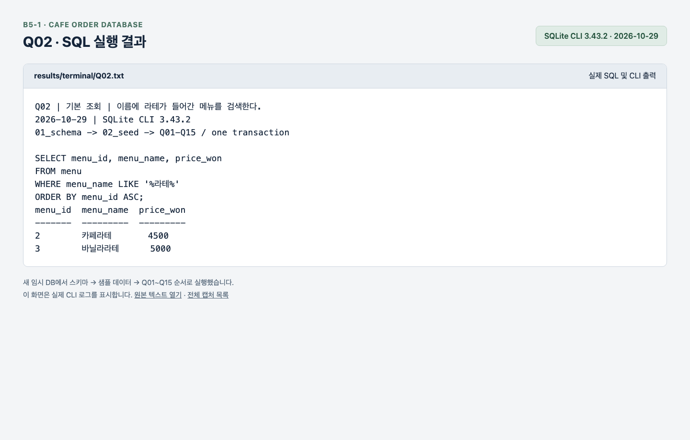
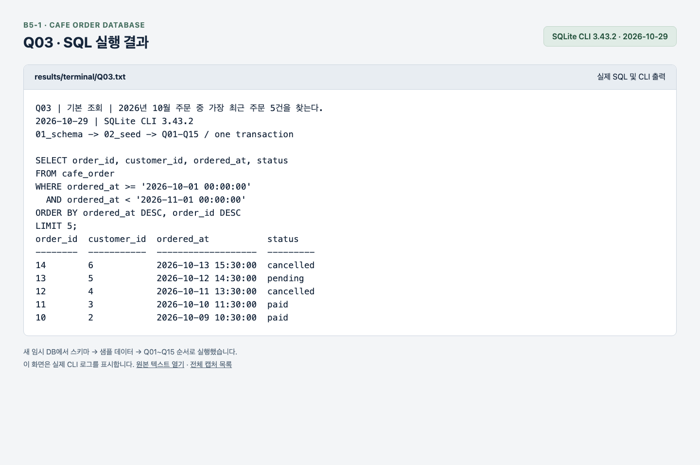
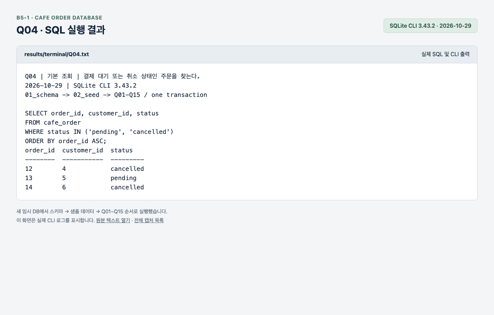
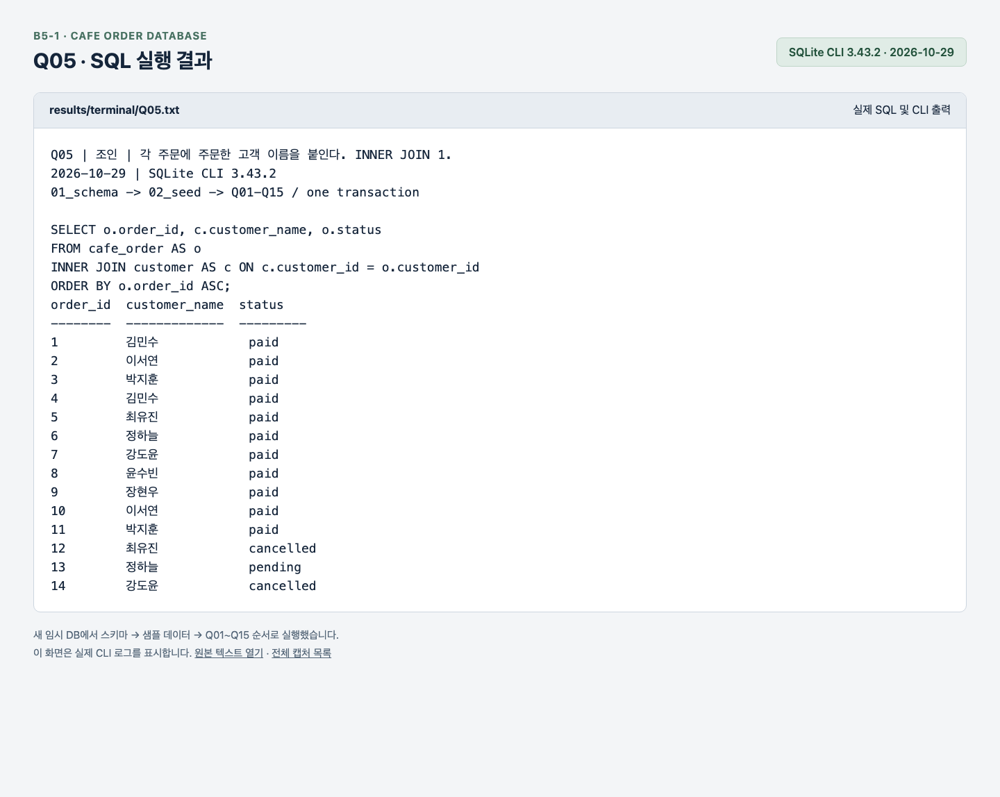
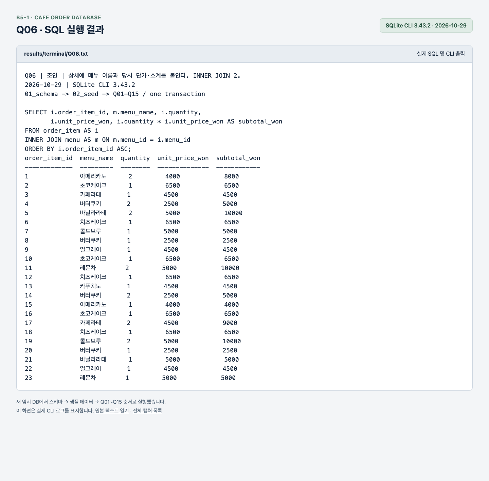
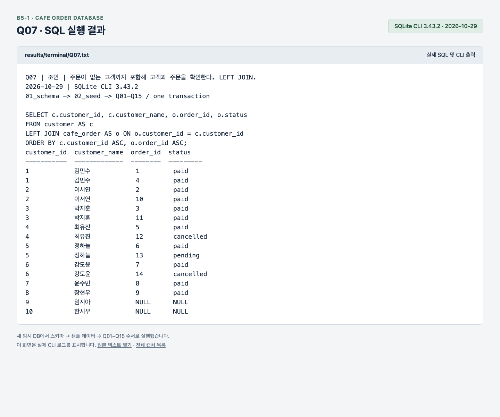
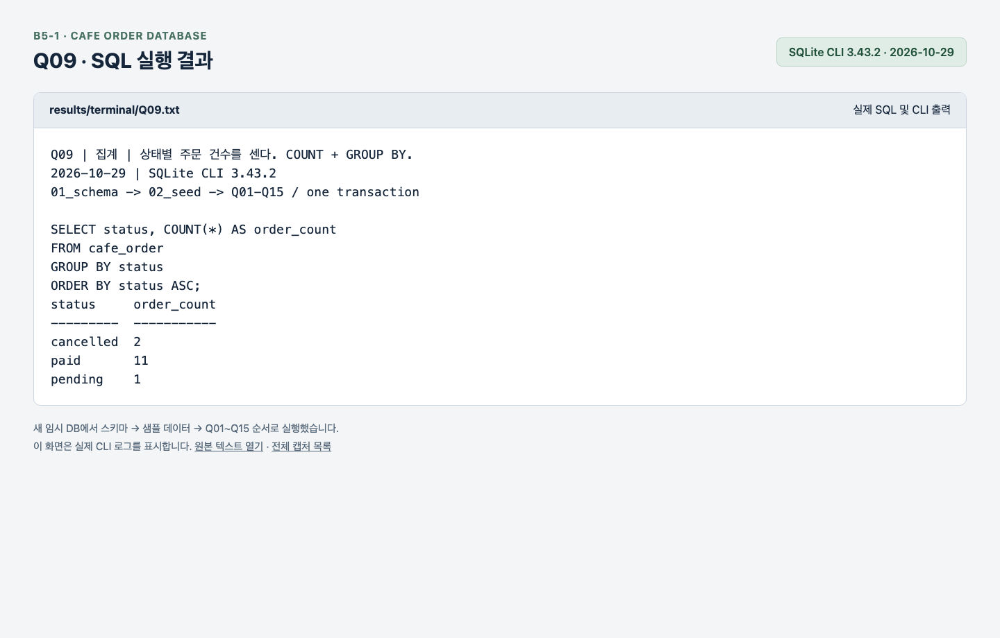
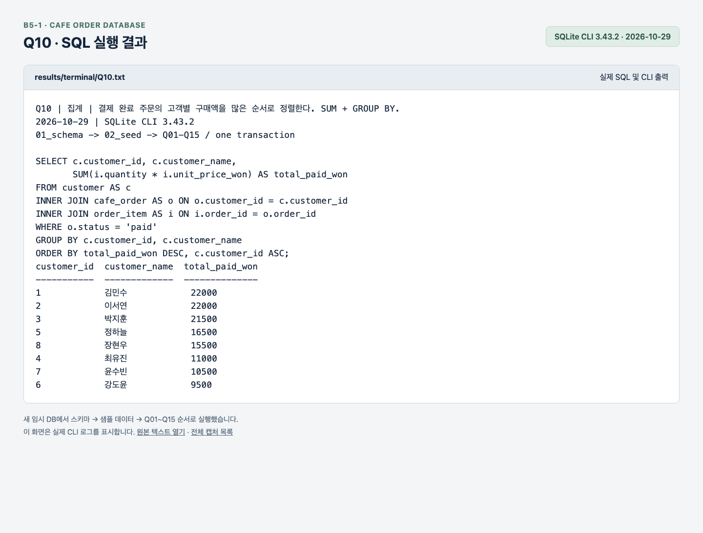
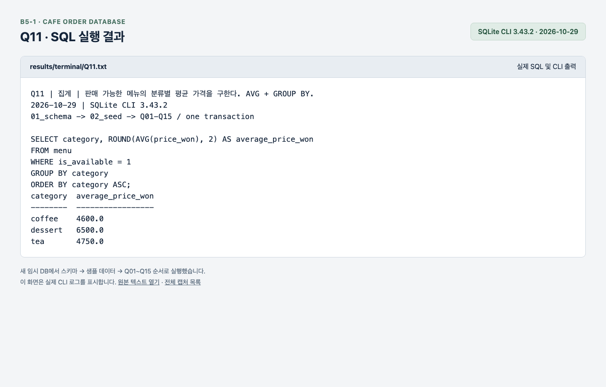
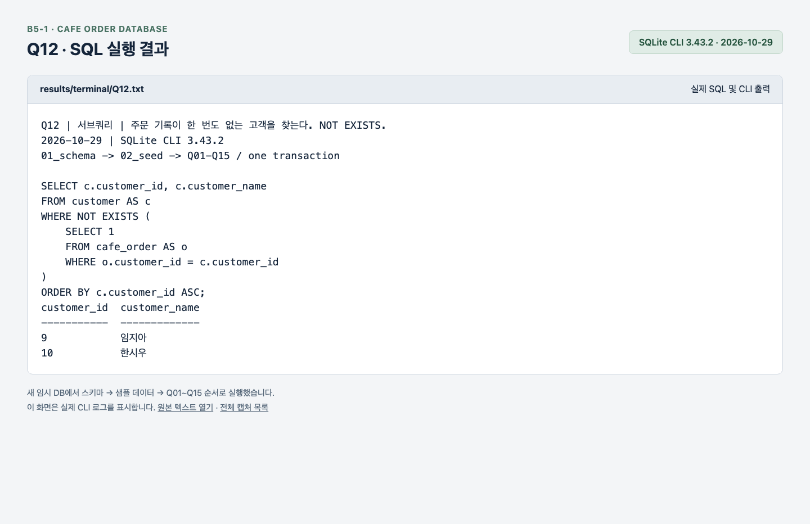

# 카페 주문 데이터베이스

SQLite로 고객·메뉴·주문·주문 상세를 관리하는 SQL 실습 프로젝트다. 테이블 생성, 샘플 데이터 입력, 조회·조인·집계·수정·삭제를 다룬다.

## 1. 파일과 읽는 순서

`01_schema.sql` → `02_seed.sql` → `03_queries.sql` → 실행 결과 순서로 확인한다.

| 파일 | 역할 |
| --- | --- |
| [01_schema.sql](sql/01_schema.sql) | 테이블 4개와 PK·FK 생성 |
| [02_seed.sql](sql/02_seed.sql) | 고객 10명·메뉴 10개·주문 14건·상세 23행 입력 |
| [03_queries.sql](sql/03_queries.sql) | 핵심 쿼리 15개 |
| [cafe.db](data/cafe.db) | 테이블과 샘플 데이터가 준비된 DB |
| [실행 화면 모음](#실행-화면) | 쿼리별 캡처 15장 |

## 2. 데이터 구조

| 테이블 | 저장 내용 | 관계 |
| --- | --- | --- |
| `customer` | 고객 이름·이메일 | 고객 1명 → 주문 여러 건 |
| `menu` | 메뉴 이름·분류·현재 가격 | 메뉴 1개 → 주문 상세 여러 줄 |
| `cafe_order` | 주문 고객·시각·상태 | 주문 1건 → 주문 상세 여러 줄 |
| `order_item` | 주문 메뉴·수량·주문 당시 단가 | 주문과 메뉴 연결 |

매출은 결제 완료(`paid`) 주문의 `quantity × unit_price_won`으로 계산한다. `price_won`은 현재 메뉴 가격, `unit_price_won`은 주문 당시 가격이다.

## 3. 실행 환경

- SQLite 3.x / `sqlite3` CLI
- WSL(Ubuntu) 또는 macOS 터미널

## 4. 실행방법

프로젝트 폴더에서 실행한다. 아래 명령은 WSL과 macOS에서 공통으로 사용한다.

### 실행 방법

```bash
sqlite3 -header -column data/cafe.db
```

### 더미 실행 방법

```bash
cp data/cafe.db data/cafe_work.db
sqlite3 -bail -header -column -echo data/cafe_work.db
```

### 전체 쿼리 실행

원본을 복사한 연습용 DB에서 실행한다. 다시 실행하면 복사 단계에서 연습용 DB가 초기화된다.

```text
.read sql/03_queries.sql
```

## 5. 핵심 쿼리 15개

| 번호 | 내용 | 실행 이미지 |
| --- | --- | --- |
| Q01 | 판매 가능한 5,000원 이상 메뉴 | [Q01 이미지](results/screenshots/Q01.png) |
| Q02 | 이름에 라떼가 포함된 메뉴 | [Q02 이미지](results/screenshots/Q02.png) |
| Q03 | 10월 최근 주문 5건 | [Q03 이미지](results/screenshots/Q03.png) |
| Q04 | 결제 대기·취소 주문 | [Q04 이미지](results/screenshots/Q04.png) |
| Q05 | 주문과 고객 연결 · INNER JOIN | [Q05 이미지](results/screenshots/Q05.png) |
| Q06 | 주문 상세와 메뉴 연결 · INNER JOIN | [Q06 이미지](results/screenshots/Q06.png) |
| Q07 | 주문 없는 고객도 포함 · LEFT JOIN | [Q07 이미지](results/screenshots/Q07.png) |
| Q08 | 고객·주문·상세·메뉴 연결 | [Q08 이미지](results/screenshots/Q08.png) |
| Q09 | 상태별 주문 수 · COUNT | [Q09 이미지](results/screenshots/Q09.png) |
| Q10 | 고객별 결제 금액 · SUM | [Q10 이미지](results/screenshots/Q10.png) |
| Q11 | 분류별 판매 메뉴 평균 가격 · AVG | [Q11 이미지](results/screenshots/Q11.png) |
| Q12 | 주문 없는 고객 · NOT EXISTS | [Q12 이미지](results/screenshots/Q12.png) |
| Q13 | 13번 주문 상태 수정 · UPDATE | [Q13 이미지](results/screenshots/Q13.png) |
| Q14 | 14번 취소 주문 삭제 · DELETE | [Q14 이미지](results/screenshots/Q14.png) |
| Q15 | 최근 주문 검색용 인덱스 생성 | [Q15 이미지](results/screenshots/Q15.png) |


### 실행 화면

<details>
<summary>Q01 · 판매 가능한 5,000원 이상 메뉴</summary>


</details>

<details>
<summary>Q02 · 이름에 라떼가 포함된 메뉴</summary>



</details>

<details>
<summary>Q03 · 10월 최근 주문 5건</summary>



</details>

<details>
<summary>Q04 · 결제 대기·취소 주문</summary>



</details>

<details>
<summary>Q05 · 주문과 고객 연결 · INNER JOIN</summary>



</details>

<details>
<summary>Q06 · 주문 상세와 메뉴 연결 · INNER JOIN</summary>



</details>

<details>
<summary>Q07 · 주문 없는 고객도 포함 · LEFT JOIN</summary>



</details>

<details>
<summary>Q08 · 고객·주문·상세·메뉴 연결</summary>


</details>

<details>
<summary>Q09 · 상태별 주문 수 · COUNT</summary>



</details>

<details>
<summary>Q10 · 고객별 결제 금액 · SUM</summary>



</details>

<details>
<summary>Q11 · 분류별 판매 메뉴 평균 가격 · AVG</summary>



</details>

<details>
<summary>Q12 · 주문 없는 고객 · NOT EXISTS</summary>



</details>

<details>
<summary>Q13 · 13번 주문 상태 수정 · UPDATE</summary>


</details>

<details>
<summary>Q14 · 14번 취소 주문 삭제 · DELETE</summary>


</details>

<details>
<summary>Q15 · 최근 주문 검색용 인덱스 생성</summary>


</details>

## 6. 오류 해결

| 오류 | 해결 |
| --- | --- |
| `no such table` | DB 경로를 확인하거나 새 DB에 01 → 02 순서로 실행한다. |
| `table ... already exists` / `UNIQUE constraint failed` | 초기화 파일을 중복 실행했는지 확인하고 새 DB에서 시작한다. |
| `FOREIGN KEY constraint failed` | 참조할 고객·주문·메뉴가 있는지 확인한다. |
| `cannot start a transaction within a transaction` | 진행 중인 작업을 COMMIT 또는 ROLLBACK한 뒤 실행한다. |

## 7. 설계와 쿼리 해설

### DB와 엑셀 비교

| 비교 항목 | 엑셀 | 이번 SQLite DB |
| --- | --- | --- |
| 관계 저장 | 시트를 나누고 조회 함수나 데이터 모델로 연결할 수 있다. 일반 셀에 고객 정보를 반복 입력하면 중복이 생기기 쉽다. | 고객·주문·메뉴·상세를 별도 테이블에 저장하고 PK/FK와 JOIN으로 연결한다. |
| 참조 무결성 | 일반 셀과 조회 함수만으로는 없는 고객 번호의 주문 저장을 막기 어렵다. 입력 검사나 별도 자동화가 필요하다. | FK 검사를 켜면 없는 고객의 주문 입력과 주문이 남아 있는 고객 삭제를 차단한다. |
| 중복·필수값·범위 | 데이터 유효성 검사와 수식으로 규칙을 직접 구성하고 유지해야 한다. | UNIQUE로 이메일 중복, NOT NULL로 이름 누락, CHECK로 0 이하 수량을 차단한다. |
| 수정과 일관성 | 셀을 직접 수정하기 편하지만 복사된 고객 이름을 여러 행에서 고치면 누락될 수 있다. | 고객 이름을 한 행에서 고치면 JOIN 결과에 반영된다. 트랜잭션으로 여러 변경을 함께 확정하거나 취소한다. |
| 장단점과 용도 | 수식·차트·피벗 테이블로 빠르게 분석하기 좋다. 관계와 입력 규칙을 계속 유지하려면 별도 관리가 필요하다. | 관계와 무결성을 일관되게 관리하고 반복 조회하기 좋다. 대신 스키마·SQL 학습과 입력 화면 구성이 필요하다. |

예를 들어 고객 1번의 이름은 `customer`에 한 번만 저장하고 주문에는 `customer_id = 1`을 기록한다. 고객 이름을 바꿀 때 주문마다 수정할 필요가 없고, 없는 고객 999번의 주문은 FK로 거부한다. 간단한 메뉴 가격표와 차트에는 엑셀이 편하고, 고객·주문·상세의 연결을 유지하는 이번 작업에는 DB가 적합하다.

### Q08: 고객의 결제 완료 주문에 담긴 메뉴 찾기

목표는 **1번 고객이 결제 완료한 주문의 메뉴와 수량을 상세별로 조회**하는 것이다.

```sql
SELECT c.customer_name, o.order_id, m.menu_name, i.quantity
FROM customer AS c
INNER JOIN cafe_order AS o ON o.customer_id = c.customer_id
INNER JOIN order_item AS i ON i.order_id = o.order_id
INNER JOIN menu AS m ON m.menu_id = i.menu_id
WHERE c.customer_id = 1 AND o.status = 'paid'
ORDER BY o.order_id ASC, i.order_item_id ASC;
```

| 단계 | 처리와 판단 근거 | 초기 데이터의 중간 결과 |
| --- | --- | --- |
| 1. 고객 필터 | 이름은 중복될 수 있으므로 PK인 `customer_id = 1`로 대상을 정한다. | 고객 1행: 김민수 |
| 2. 주문 연결·상태 필터 | 고객 번호로 주문을 연결하고 `status = 'paid'`만 남긴다. 결제 대기·취소는 제외한다. | 주문 2행: 1번·4번 |
| 3. 상세 연결 | 주문 번호로 `order_item`을 연결해 메뉴 번호와 수량을 얻는다. 주문 하나에 메뉴가 여러 개이므로 행 수가 늘어난다. | 상세 4행: 주문 1번의 메뉴 1·8, 주문 4번의 메뉴 5·10 |
| 4. 메뉴 연결 | 메뉴 번호로 `menu`를 연결해 메뉴 이름을 얻는다. 현재 판매 중단 여부로 과거 주문을 제외하지 않는다. | 아메리카노·초코케이크·콜드브루·버터쿠키 |
| 5. 열 선택·정렬 | 고객 이름·주문 번호·메뉴 이름·수량을 표시하고 주문 번호 → 상세 번호 순으로 정렬한다. 상세별 조회이므로 집계하지 않는다. | 최종 결과 4행 |

INNER JOIN은 연결된 주문 상세만 조회하려는 목적에 맞는다. 주문 없는 고객도 보여줘야 하는 Q07에서는 LEFT JOIN을 사용한다. 위 단계는 결과를 이해하기 위한 논리적 순서이며, SQLite의 실제 실행 순서는 옵티마이저가 정한다.

| 고객 | 주문 번호 | 메뉴 | 수량 |
| --- | --- | --- | --- |
| 김민수 | 1 | 아메리카노 | 2 |
| 김민수 | 1 | 초코케이크 | 1 |
| 김민수 | 4 | 콜드브루 | 1 |
| 김민수 | 4 | 버터쿠키 | 1 |

결과는 상세 4행이며 메뉴 수량 합계는 5개다.

### Q10: 고객별 결제 금액 집계

1. 주문에서 `status = 'paid'`만 남겨 결제 대기·취소 금액을 제외한다.
2. 고객 번호로 `customer`를, 주문 번호로 `order_item`을 연결한다.
3. 상세마다 `quantity * unit_price_won`을 계산한다. 현재 메뉴 가격 대신 주문 당시 단가를 사용한다.
4. `GROUP BY customer_id, customer_name`으로 고객별 상세를 묶고 `SUM`으로 합산한다.
5. 합계 내림차순, 같은 금액이면 고객 번호 오름차순으로 정렬한다.

초기 데이터에서 김민수는 1번 주문 14,500원 + 4번 주문 7,500원 = 22,000원이다. 이서연도 22,000원이며 고객 번호가 작은 김민수가 먼저 나온다. [Q10 실행 이미지](results/screenshots/Q10.png)

### Q12: 주문이 없는 고객 찾기

1. 바깥 조회에서 고객을 한 명씩 대상으로 삼는다.
2. 내부 서브쿼리의 `o.customer_id = c.customer_id`로 해당 고객의 주문이 존재하는지 확인한다. 결제 상태와 무관하게 주문 기록 전체를 검사한다.
3. `NOT EXISTS`로 주문이 한 건도 없는 고객만 남기고 고객 번호순으로 정렬한다.

초기 데이터에서는 9번 임지아와 10번 한시우가 반환된다. [Q12 실행 이미지](results/screenshots/Q12.png)
