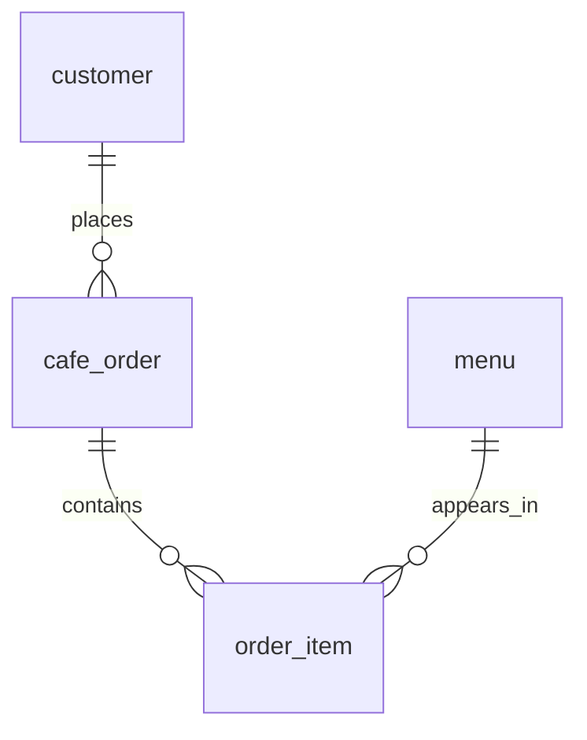

# B5-1 카페 주문 데이터베이스

고객·메뉴·주문·주문 상세를 나눠 저장하고, SQL로 검색·조인·집계·수정·삭제하는 실습이다. 첨부 B5-1 PDF의 필수 제출물인 SQL 3개와 쿼리별 실제 결과 텍스트를 제공한다. 백엔드 프레임워크·뷰·프로시저·트리거는 사용하지 않는다.

2026-10-27 학습 자료 개정: 학습 목표 요약, 용어별 기본·비유 설명, 질문 10개와 해설, 확장 과제를 정리했다. Python 보조 예제에 PEP 8을 적용하고 SQL 결과·제약조건 차단·문서 예시를 재검증했다.

## 1. 파일과 읽는 순서

| 파일 | 역할 |
| --- | --- |
| `sql/01_schema.sql` | 테이블 4개와 PK·FK·제약조건 생성 |
| `sql/02_seed.sql` | 고객 10명·메뉴 10개·주문 14건·주문 상세 23행 입력 |
| `sql/03_queries.sql` | 목적을 주석으로 적은 핵심 SQL 15개 |
| `data/cafe.db` | 스키마와 샘플 입력까지 완료한 SQLite DB. 핵심 쿼리 실행 전 상태 |
| `results/Q01.txt` ~ `Q15.txt` | 각 핵심 쿼리의 SQL과 실제 실행 결과 |
| `results/validation.txt` | FK·UNIQUE·NOT NULL·CHECK 등 오류 차단 기록 |
| `results/summary.txt` | 실제 환경 버전·검증 범위·실행 후 상태 |
| `docs/basic_knowledge.md` | 학습 목표·용어와 비유·설계 원리·질문과 해설·확장·책 한 권 |
| `docs/code_translation.md` | SQL 전체 구조와 의미 있는 소스 각 줄의 해설 |

학습 문서는 먼저 관계와 SQL을 이해하고, 질문으로 결과를 예상한 뒤 작은 쿼리를 바꿔 보는 순서로 구성했다.

처음에는 이 README → `docs/basic_knowledge.md` → SQL 순서로 읽는다. 코드를 읽다가 모르는 줄은 `docs/code_translation.md`에서 실제 원본 줄 번호로 찾는다. `results/`는 직접 실행한 SQL 결과이며 예상값을 손으로 만든 표가 아니다.

## 2. 데이터 구조와 처리 흐름

| 부모 | 자식 | 연결 열 | 의미 |
| --- | --- | --- | --- |
| `customer` | `cafe_order` | `customer_id` | 고객 1명이 주문 여러 건을 만들 수 있다. |
| `cafe_order` | `order_item` | `order_id` | 주문 1건에 여러 메뉴 상세를 담는다. |
| `menu` | `order_item` | `menu_id` | 메뉴 1개가 여러 주문 상세에 등장할 수 있다. |



주문과 메뉴의 N:M 관계는 `order_item`으로 풀었다. 같은 주문·메뉴 조합은 한 줄로 두고 개수는 `quantity`로 표현한다. 주문이 없는 고객도 정상 데이터다. 주문 작성 중이거나 취소된 주문은 상세가 0줄일 수 있다.

`price_won`은 현재 메뉴 가격, `unit_price_won`은 주문 당시 가격이다. 매출은 `quantity * unit_price_won`으로 계산하고 `paid` 주문만 포함한다. 결제 대기·취소 주문의 금액은 매출에서 제외한다. 메뉴의 판매 중단은 과거 상세를 삭제한다는 뜻이 아니다.

## 3. 실행 환경

- DB: 로컬 SQLite. 검증에 사용한 엔진은 **3.53.1**이다. 최신 전용 기능 없이 일반적인 SQLite 문법을 사용한다.
- 실제 검증 도구: Python 3.12.14의 표준 `sqlite3` 모듈. 별도 Python 앱은 제출물에 포함하지 않았다.
- 직접 실습할 SQL 도구: SQLite 공식 CLI 또는 SQLite를 지원하는 로컬 SQL 편집기.
- 파일 인코딩: UTF-8. 금액: 원 단위 정수. 날짜: `YYYY-MM-DD HH:MM:SS` 형식의 TEXT.
- GUI 조작과 독립 `sqlite3` CLI는 이 환경에서 실행하지 않았다. SQL 파일 3개는 SQLite 엔진에서 실제 실행했다.

SQLite 전용 부분은 `PRAGMA foreign_keys`, `INTEGER PRIMARY KEY`의 rowid 연결, 날짜 TEXT 사용이다. MySQL/PostgreSQL에 그대로 복사해 실행하는 프로젝트가 아니다. SQLite는 일반 테이블의 타입을 유연하게 처리하므로 `INTEGER` 선언만으로 모든 비정수 입력을 막는다고 이해하면 안 된다. 날짜 형식·이메일 형식·빈 이름 검증은 이 실습의 제약에 포함하지 않았다.

## 4. 빠른 시작

ZIP을 먼저 압축 해제한다. DB 도구에서 `data/cafe.db`를 열면 초기 데이터가 바로 보인다. 연습할 때는 이 파일을 복사해 `cafe_work.db`로 열어도 된다.

### 방법 A: SQL 편집기

1. SQLite 연결을 만들고 `data/cafe.db` 또는 복사본을 연다.
2. 실행 중인 트랜잭션이 없는 상태에서 `PRAGMA foreign_keys = ON;`을 실행한다.
3. `PRAGMA foreign_keys;`를 실행해 결과가 **1**인지 확인한다. 설정은 연결마다 필요하다.
4. `sql/03_queries.sql`의 Q01~Q12를 쿼리별로 선택해 실행한다. 세미콜론까지 선택한다.
5. Q13~Q14는 데이터를 변경하고 Q15는 인덱스를 만든다. 아래 변경 내역을 읽은 뒤 실행한다.

전체 SQL 파일을 스크립트로 실행할 수도 있다. 파일 내부에 BEGIN/COMMIT이 있으므로 도구가 별도 트랜잭션을 먼저 열지 않게 설정한다. 수동 트랜잭션 도구라면 먼저 기존 작업을 COMMIT/ROLLBACK하고 진행한다. 이미 초기화된 `cafe.db`에 01·02를 다시 실행하면 중복 오류가 나는 것이 정상이다.

### 방법 B: SQLite 공식 CLI로 처음부터 만들기

[공식 다운로드](https://sqlite.org/download.html)에서 운영체제에 맞는 SQLite tools를 준비한다. Windows에서는 `sqlite3.exe`가 들어 있는 폴더를 PATH에 추가하거나 실행 파일의 전체 경로로 호출한다. 아래 명령은 PATH에 등록되어 있다고 가정한다. 설치 프로그램이나 패키지 설치 명령은 이 결과물에서 실행하지 않았다.

터미널의 현재 위치를 압축 해제한 `b5-1-cafe` 폴더로 옮긴다. 다음 `cafe_practice.db`는 **아직 없는 새 파일명**을 사용한다.

Windows PowerShell 또는 Linux Bash에서:

```text
sqlite3 cafe_practice.db
```

SQLite가 시작된 다음 아래를 입력한다. 점으로 시작하는 명령은 SQL이 아니라 SQLite CLI 전용 명령이다. PowerShell에 그대로 붙이는 명령이 아니다.

```text
.bail on
.headers on
.mode list
.read sql/01_schema.sql
.read sql/02_seed.sql
PRAGMA foreign_keys;
SELECT COUNT(*) FROM cafe_order;
.echo on
.output results/my_run.txt
.read sql/03_queries.sql
.output stdout
.echo off
.quit
```

초기 주문 수는 14, 외래 키 설정은 1이다. `.output` 이후 결과는 `results/my_run.txt`에 기록된다. Q13·Q14는 SELECT처럼 표를 반환하지 않으므로 변경 확인용 SQL은 다음 절을 사용한다. 제공된 `Q13.txt`, `Q14.txt`에는 실행 전·후 상태와 변경 행 수가 함께 기록되어 있다.

### SQLite 실행 파일 없이 SQL 엔진으로 재현하기

Python이 이미 있는 경우 다음 방법으로도 새 DB를 만들 수 있다. 이것은 실행을 돕는 절차이고 별도 백엔드 프로그램이 아니다. `b5-1-cafe` 폴더에서 PowerShell은 `py`, Linux는 `python3`로 대화형 Python을 시작한다. 다음은 Python 콘솔에 한 줄씩 입력한다.

```python
import sqlite3
from pathlib import Path

connection = sqlite3.connect('cafe_python_practice.db')
schema_sql = Path('sql/01_schema.sql').read_text(encoding='utf-8')
seed_sql = Path('sql/02_seed.sql').read_text(encoding='utf-8')
query_sql = Path('sql/03_queries.sql').read_text(encoding='utf-8')

connection.executescript(schema_sql)
connection.executescript(seed_sql)
connection.execute('PRAGMA foreign_keys').fetchall()
connection.execute('SELECT COUNT(*) FROM cafe_order').fetchall()
connection.executescript(query_sql)
connection.execute(
    "SELECT order_id, status FROM cafe_order WHERE order_id = 13"
).fetchall()
connection.close()
```

Python 보조 예제는 PEP 8의 공백과 79자 줄 길이를 적용했다. SQL은 대문자 키워드·의미 있는 이름·들여쓰기 등 SQL 관례를 따른다.

처음 두 조회 결과는 `[(1,)]`, `[(14,)]`, 마지막 조회는 `[(13, 'paid')]`다. `executescript`는 여러 SQL을 실행하지만 SELECT 결과를 화면에 자동 출력하지 않는다. Q01~Q12의 표를 보려면 SQL 편집기에서 실행하거나 각각 `connection.execute('조회 SQL').fetchall()`로 조회한다. 오류가 나면 계속 실행하지 말고 `connection.rollback()` 후 원인을 해결한다. 재시도는 새 파일명으로 시작한다.

## 5. 핵심 쿼리 15개

각 번호는 아래 **주된 범주 한 곳에서만** 센다. 스키마 DDL·샘플 INSERT·검증용 SQL은 15개에 포함하지 않는다.

| 번호 | 주된 범주 | 목적 | 결과 |
| --- | --- | --- | --- |
| Q01 | 기본 조회 | 판매 가능한 5,000원 이상 메뉴, 가격순 | [Q01](results/Q01.txt) |
| Q02 | 기본 조회 | 이름에 라테가 포함된 메뉴 검색 | [Q02](results/Q02.txt) |
| Q03 | 기본 조회 | 10월 최근 주문 5건, 기간·정렬·LIMIT | [Q03](results/Q03.txt) |
| Q04 | 기본 조회 | 결제 대기·취소 주문 | [Q04](results/Q04.txt) |
| Q05 | 조인 | 주문 + 고객, INNER JOIN | [Q05](results/Q05.txt) |
| Q06 | 조인 | 상세 + 메뉴, INNER JOIN | [Q06](results/Q06.txt) |
| Q07 | 조인 | 주문 없는 고객도 포함, LEFT JOIN | [Q07](results/Q07.txt) |
| Q08 | 조인 | 고객·주문·상세·메뉴 연결 | [Q08](results/Q08.txt) |
| Q09 | 집계 | 상태별 주문 수, COUNT·GROUP BY | [Q09](results/Q09.txt) |
| Q10 | 집계 | 결제 완료 고객별 구매액, SUM·GROUP BY | [Q10](results/Q10.txt) |
| Q11 | 집계 | 분류별 판매 메뉴 평균 가격, AVG·GROUP BY | [Q11](results/Q11.txt) |
| Q12 | 서브쿼리 | 주문 없는 고객, NOT EXISTS | [Q12](results/Q12.txt) |
| Q13 | 수정 | 13번 결제 대기 주문을 paid로 변경 | [Q13](results/Q13.txt) |
| Q14 | 삭제 | 상세 없는 14번 취소 주문 삭제 | [Q14](results/Q14.txt) |
| Q15 | 인덱스 | Q03의 주문 시각 범위·정렬 지원 | [Q15](results/Q15.txt) |

기본 조회 4 + 조인 4 + 집계 3 + 서브쿼리 1 + 수정·삭제 2 + 인덱스 1 = **15개**다. 집계에는 COUNT·SUM·AVG를 모두 사용했다.

## 6. 실제 결과와 변경 순서

2026-10-27에 새 DB에서 재실행한 결과다. 전체 내역과 정확한 실행 시각은 `results/`를 참조한다.

- Q09: `paid` 11건, `cancelled` 2건, `pending` 1건.
- Q10: 1번 김민수와 2번 이서연은 각각 22,000원으로 공동 최고 구매액이다. 같은 금액이면 고객 번호로 정렬한다.
- Q11: 판매 중인 coffee 평균 4,600원, tea 4,750원, dessert 6,500원.
- Q12: 9번 임지아·10번 한시우가 주문 없는 고객이다.
- Q13: 13번 주문이 `pending` → `paid`, 변경 1행.
- Q14: 14번 취소 주문 삭제 1행. 주문 수 14 → 13, 상세 수 23 유지.
- Q15: 인덱스 생성 전에는 `SCAN`과 정렬용 임시 B-tree, 생성 후에는 `idx_cafe_order_recent`을 쓰는 `SEARCH`를 확인했다. 실행 속도가 빨라졌다는 시간 측정은 하지 않았다.

Q01~Q12의 저장 결과는 **Q13~Q14 실행 전** 기준이다. 전체 파일을 다시 실행하면 Q13·Q14 변경 행 수는 0이 되고, 앞부분 조회도 달라진다. 수정 후 Q09는 paid 12·cancelled 1, Q10의 5번 고객 구매액은 21,500원이다.

수정·삭제 확인용 SQL이며 핵심 15개에는 포함하지 않는다. SQLite에서 `changes()`는 해당 연결의 **가장 최근 변경 SQL 직후** 실행한다.

```sql
SELECT changes() AS changed_rows;
SELECT order_id, status FROM cafe_order WHERE order_id IN (13, 14);
SELECT COUNT(*) AS order_count FROM cafe_order;
```

### 초기 데이터 복구

새 빈 DB 파일을 만들고 01 → 02 순서로 실행한다. 초기 상태인 `data/cafe.db`의 복사본을 새로 만들어도 된다. 기존 작업 파일을 지울 필요는 없다. 01은 자동 삭제나 DROP을 하지 않고, 02는 같은 데이터 재입력을 허용하는 스크립트가 아니다.

실행 중 오류가 나면 후속 쿼리 실행을 중단하고 같은 연결에서 `ROLLBACK;`한다. 이미 COMMIT된 변경은 ROLLBACK으로 되돌릴 수 없으므로 새 DB로 초기화한다.

## 7. 오류 해결과 검증 재현

| 증상 | 원인과 해결 |
| --- | --- |
| `no such table` | 잘못된 DB 파일을 열었거나 스키마를 아직 실행하지 않았다. DB 경로와 01 → 02 순서를 확인한다. |
| `table ... already exists` | 초기화된 DB에 01을 다시 실행했다. 새 빈 파일을 만든다. |
| `UNIQUE constraint failed` | 02를 재입력했거나 중복 ID·이메일·메뉴 이름 등을 넣었다. 새 DB에서 시작하거나 중복값을 수정한다. |
| `FOREIGN KEY constraint failed` | 부모가 없거나, 참조 중인 부모를 삭제했다. 부모 ID와 자식 행을 먼저 확인한다. 무작정 FK를 끄지 않는다. |
| `cannot start a transaction within a transaction` | 도구가 이미 트랜잭션을 열었다. 기존 작업을 정리하고 파일의 BEGIN 전에 트랜잭션이 없게 한다. |
| 없는 고객 번호 입력이 통과함 | 같은 연결에서 `PRAGMA foreign_keys;`가 1인지, ON을 트랜잭션 밖에서 실행했는지 확인한다. |
| 한글이 깨짐 | SQL·결과 파일을 UTF-8로 열고 터미널 표시 인코딩도 확인한다. |

새 DB에서 01·02 실행 후 아래로 확인할 수 있다.

```sql
PRAGMA foreign_keys;
PRAGMA foreign_key_check;
PRAGMA integrity_check;
SELECT 'customer' AS table_name, COUNT(*) AS row_count FROM customer
UNION ALL SELECT 'menu', COUNT(*) FROM menu
UNION ALL SELECT 'cafe_order', COUNT(*) FROM cafe_order
UNION ALL SELECT 'order_item', COUNT(*) FROM order_item;
```

결과는 FK 설정 1, FK 위반 0행, integrity_check `ok`, 행 수 10·10·14·23이다. 외래 키 실제 차단·NULL·중복·체크 조건 등을 13건 시도해 모두 거부됨을 확인했다. 시도한 SQL과 실제 오류는 `results/validation.txt`에 있다. 실패한 입력은 SAVEPOINT로 되돌려 검증 DB를 보존했다. 성공만 전제하는 코드 유무 검사와 별개로 실제 SQL 엔진 동작을 확인했다.

## 8. 요구사항 충족표

원문 위치는 첨부 PDF의 물리 페이지(총 6쪽) 기준이다. 제공 프로필 요약의 쪽수보다 이번 첨부 원문을 우선했다. 보너스 3종과 ERD 이미지는 필수가 아니므로 별도 구현 범위에 넣지 않았다. 위 관계도는 문서 내 참고용이다. 실제 FK 실패 시도는 필수 FK 동작 검증을 위한 증거다.

| 요구사항 | 필수/권장/선택 | 원문 위치 | 구현·설정 위치 | 검증 방법 | 상태·증거 |
| --- | --- | --- | --- | --- | --- |
| 로컬 DB·SQL 실행 도구 | 필수 | 2~3쪽 §4.1 | SQLite, Python 표준 sqlite3 | 새 파일 DB 접속·SQL 실행 | 충족: summary.txt |
| 테이블 4개 이상·각 PK | 필수 | 2~3쪽 §2·§4.2 | 01_schema.sql | sqlite_master·table_info 정적/실행 확인 | 충족: customer/menu/cafe_order/order_item |
| FK 2개 이상·1:N 2개 이상 | 필수 | 2~3쪽 §2·§4.2 | FK 3개 | 연결 입력 및 없는 부모 거부 | 충족: validation.txt |
| 의미 있는 타입·명명 | 필수 | 3쪽 §4.2 | INTEGER·TEXT, 원 단위·ISO 날짜 | 스키마·샘플 검토 | 충족: 01_schema.sql |
| NOT NULL·UNIQUE 각각 1개 이상 | 필수 | 3쪽 §4.3 | 이름/이메일/메뉴 등 | NULL·중복 이메일 입력 거부 | 충족: validation.txt |
| FK 실제 동작 | 필수 | 3쪽 §4.3 | 각 SQL의 PRAGMA ON | 존재하지 않는 FK 3종·부모 삭제 시도 | 충족: validation.txt |
| 각 테이블 10행 이상·부모 먼저 입력 | 필수 | 3~4쪽 §4.4 | 02_seed.sql | COUNT 및 FK 검사 | 충족: 10·10·14·23행 |
| 기본 조회 4개, WHERE/ORDER BY/LIMIT | 필수 | 4쪽 §4.5 | Q01~Q04 | 실제 실행 | 충족: Q01~Q04.txt |
| 조인 4개, INNER 2개·LEFT 1개 이상 | 필수 | 4쪽 §4.5 | Q05~Q08 | NULL 포함 연결 결과 확인 | 충족: Q05~Q08.txt |
| 집계 3개, 함수 2종 이상·GROUP BY | 필수 | 4쪽 §4.5 | Q09~Q11 | COUNT·SUM·AVG 실제 결과 | 충족: Q09~Q11.txt |
| 서브쿼리 1개 이상 | 필수 | 4쪽 §4.5 | Q12 | 주문 없는 고객 9·10번 확인 | 충족: Q12.txt |
| UPDATE·DELETE | 필수 | 4쪽 §4.5 | Q13~Q14 | 전후 행·변경 수 확인 | 충족: Q13~Q14.txt |
| CREATE INDEX·이유 1줄 | 필수 | 4쪽 §4.5 | Q15 주석·인덱스 | sqlite_master·실행 계획 확인 | 충족: Q15.txt |
| 쿼리별 목적·실행 결과 | 필수 | 4쪽 §4.6 | Q01~Q15 주석·results/ | SQL과 텍스트 대조 | 충족: 결과 15개 |
| SQL 3개·결과 폴더 | 필수 | 4~5쪽 §4.7·§7 | sql/·results/ | 파일 구성 확인 | 충족 |
| 백엔드·뷰·프로시저·트리거 미사용 | 필수 | 5쪽 §7 | SQL 3개 전체 | 코드 및 sqlite_master 확인 | 충족 |
| 표준 SQL 위주·DB 전용 문법 표시 | 권장/전용 사용 시 명시 | 3쪽 §4.1 | 01 주석·각 PRAGMA 해설 | 방언 검토 | 충족: SQLite 명시 |
| ERD 이미지 | 선택 | 4~5쪽 제출물 | 문서 관계도로 설명 | 이미지 파일은 미생성 | 선택 범위 제외 |
| JOIN 대안·정합성 파괴 보고·지표 리포트 | 보너스 | 4~5쪽 §5 | 필수 결과물과 분리 | 별도 보너스 SQL·보고서 미작성 | 미선택 |

## 9. 공식 참고 자료

- [SQLite CLI 문서](https://sqlite.org/cli.html): `.read`, `.output`, `.headers` 등. SQLite library와 독립 CLI는 별개다.
- [SQLite 외래 키 문서](https://sqlite.org/foreignkeys.html): 연결별 FK 설정과 트랜잭션 중 변경 제한.
- 책의 출판 정보·전자책 확인 출처는 [기초 지식 문서](docs/basic_knowledge.md)에 적었다.

SQLite CLI 문서는 2026-10-16, 외래 키·집계 함수와 책의 출판 정보는 2026-10-27에 확인했다. 사용자의 PC 설치·GUI 화면 동작은 미확인이다.
