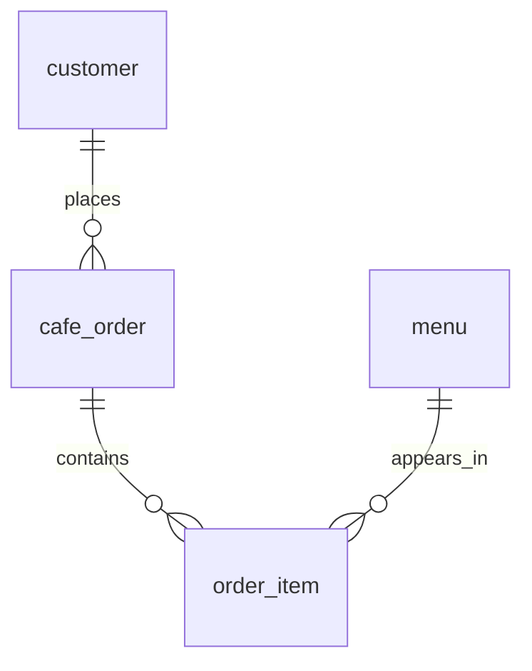

# 카페 주문 데이터베이스

고객·메뉴·주문·주문 상세를 나눠 저장하고, SQL로 검색·조인·집계·수정·삭제하는 실습이다.

## 1. 파일과 읽는 순서

| 파일 | 역할 |
| --- | --- |
| `sql/01_schema.sql` | 테이블 4개와 PK·FK·제약조건 생성 |
| `sql/02_seed.sql` | 고객 10명·메뉴 10개·주문 14건·주문 상세 23행 입력 |
| `sql/03_queries.sql` | 목적을 주석으로 적은 핵심 SQL 15개 |
| `data/cafe.db` | 스키마와 샘플 입력까지 완료한 SQLite DB. 핵심 쿼리 실행 전 상태 |
| `results/Q01.txt` ~ `Q15.txt` | 각 핵심 쿼리의 SQL과 실제 실행 결과 |
| `results/validation.txt` | FK·UNIQUE·NOT NULL·CHECK 등 오류 차단 기록 |
| `results/summary.txt` | 실제 환경 버전·검증 범위·실행 후 상태 |

## 2. 데이터 구조와 처리 흐름

| 부모 | 자식 | 연결 열 | 의미 |
| --- | --- | --- | --- |
| `customer` | `cafe_order` | `customer_id` | 고객 1명이 주문 여러 건을 만들 수 있다. |
| `cafe_order` | `order_item` | `order_id` | 주문 1건에 여러 메뉴 상세를 담는다. |
| `menu` | `order_item` | `menu_id` | 메뉴 1개가 여러 주문 상세에 등장할 수 있다. |

## 3. 핵심 쿼리 15개

각 번호는 아래 **주된 범주 한 곳에서만** 센다. 스키마 DDL·샘플 INSERT·검증용 SQL은 15개에 포함하지 않는다.

| 번호 | 주된 범주 | 목적 | 결과 |
| --- | --- | --- | --- |
| Q01 | 기본 조회 | 판매 가능한 5,000원 이상 메뉴, 가격순 | [Q01](results/Q01.txt) |
| Q02 | 기본 조회 | 이름에 라테가 포함된 메뉴 검색 | [Q02](results/Q02.txt) |
| Q03 | 기본 조회 | 10월 최근 주문 5건, 기간·정렬·LIMIT | [Q03](results/Q03.txt) |
| Q04 | 기본 조회 | 결제 대기·취소 주문 | [Q04](results/Q04.txt) |
| Q05 | 조인 | 주문 + 고객, INNER JOIN | [Q05](results/Q05.txt) |
| Q06 | 조인 | 상세 + 메뉴, INNER JOIN | [Q06](results/Q06.txt) |
| Q07 | 조인 | 주문 없는 고객도 포함, LEFT JOIN | [Q07](results/Q07.txt) |
| Q08 | 조인 | 고객·주문·상세·메뉴 연결 | [Q08](results/Q08.txt) |
| Q09 | 집계 | 상태별 주문 수, COUNT·GROUP BY | [Q09](results/Q09.txt) |
| Q10 | 집계 | 결제 완료 고객별 구매액, SUM·GROUP BY | [Q10](results/Q10.txt) |
| Q11 | 집계 | 분류별 판매 메뉴 평균 가격, AVG·GROUP BY | [Q11](results/Q11.txt) |
| Q12 | 서브쿼리 | 주문 없는 고객, NOT EXISTS | [Q12](results/Q12.txt) |
| Q13 | 수정 | 13번 결제 대기 주문을 paid로 변경 | [Q13](results/Q13.txt) |
| Q14 | 삭제 | 상세 없는 14번 취소 주문 삭제 | [Q14](results/Q14.txt) |
| Q15 | 인덱스 | Q03의 주문 시각 범위·정렬 지원 | [Q15](results/Q15.txt) |

기본 조회 4 + 조인 4 + 집계 3 + 서브쿼리 1 + 수정·삭제 2 + 인덱스 1 = **15개**다. 집계에는 COUNT·SUM·AVG를 모두 사용했다.
