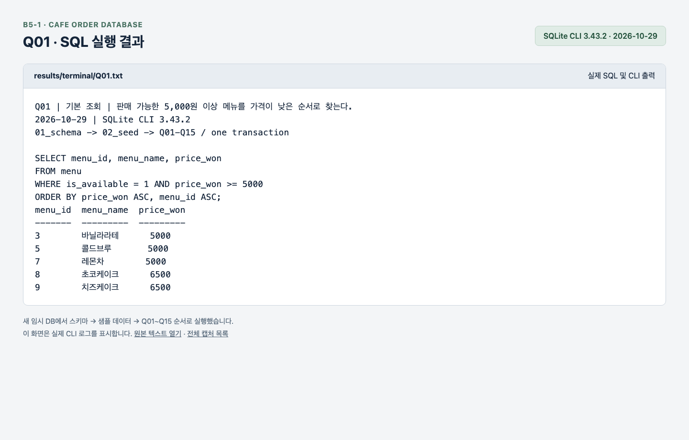
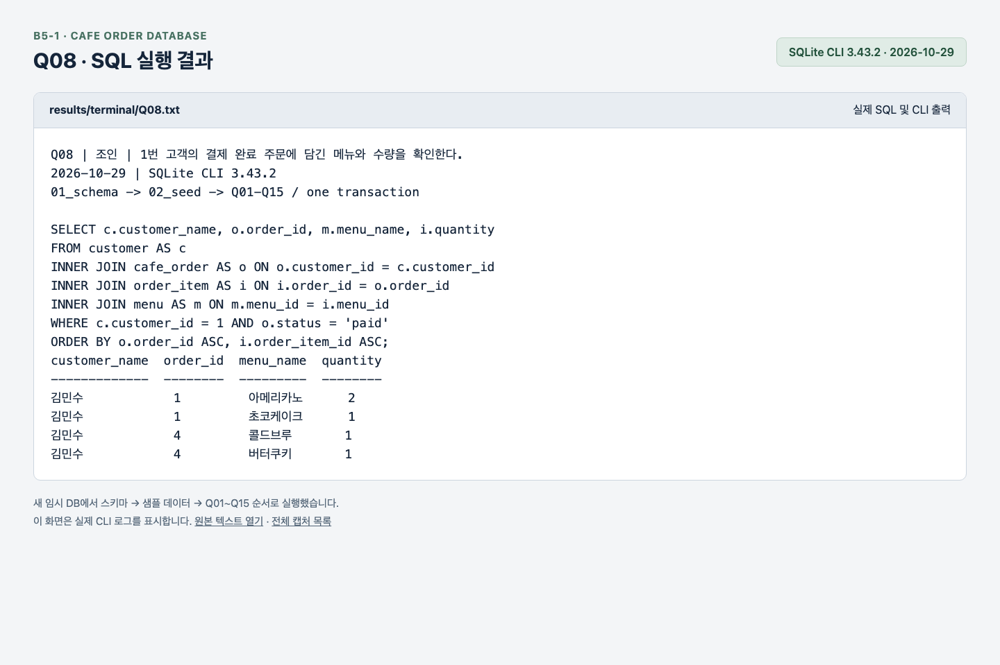
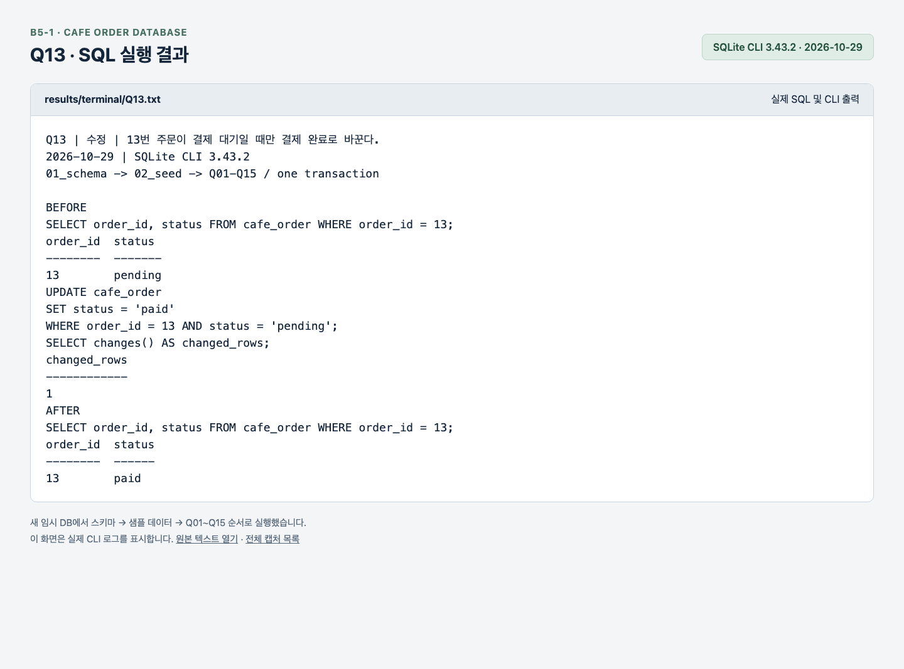
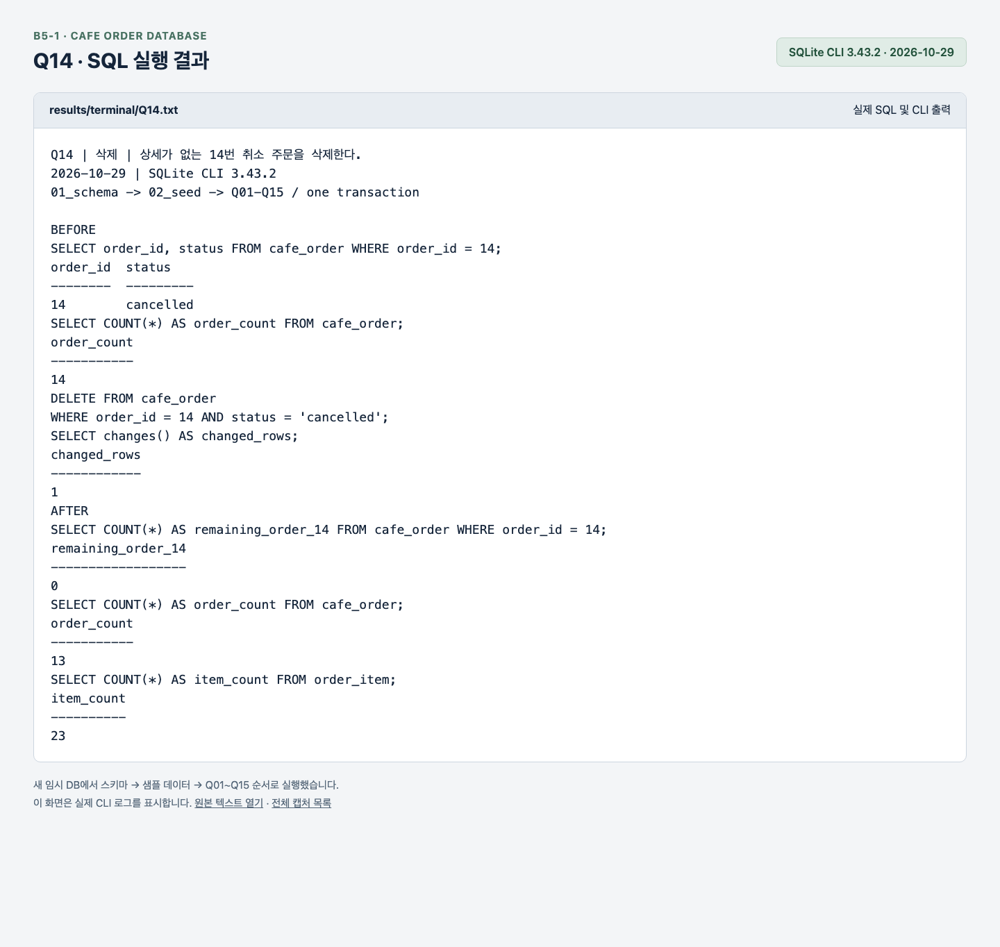
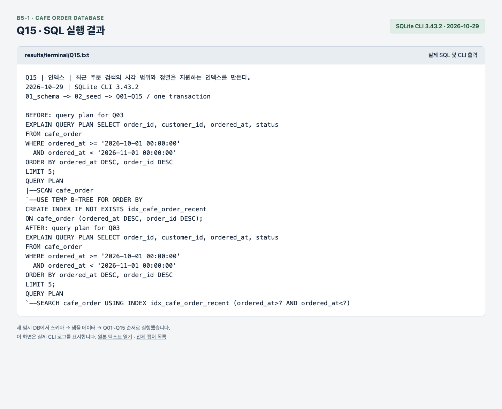

# SQL 실행 화면

2026-10-29에 SQLite CLI 3.43.2로 새 임시 DB를 만들고 `01_schema.sql` → `02_seed.sql` → Q01~Q15를 실행했다. 핵심 쿼리는 한 연결의 BEGIN/COMMIT 안에서 순서대로 실행했다.

각 PNG는 실제 CLI 출력을 결과 보기 화면에 표시하고 Chrome에서 캡처한 이미지다. SQL과 실행 결과를 함께 담았다. Q01~Q12는 수정·삭제 전 상태이고, Q13·Q14는 변경 전후와 변경 행 수, Q15는 인덱스 생성 전후 실행 계획을 보여준다.

| 쿼리 | 실행 내용 | 실행 결과 화면 |
| --- | --- | --- |
| Q01 | 판매 가능한 5,000원 이상 메뉴 | [Q01.png](Q01.png) |
| Q02 | 라떼 이름 검색 | [Q02.png](Q02.png) |
| Q03 | 10월 최근 주문 5건 | [Q03.png](Q03.png) |
| Q04 | 결제 대기·취소 주문 | [Q04.png](Q04.png) |
| Q05 | 주문과 고객 INNER JOIN | [Q05.png](Q05.png) |
| Q06 | 상세와 메뉴·소계 | [Q06.png](Q06.png) |
| Q07 | 주문 없는 고객까지 LEFT JOIN | [Q07.png](Q07.png) |
| Q08 | 고객·주문·상세·메뉴 연결 | [Q08.png](Q08.png) |
| Q09 | 상태별 주문 수 | [Q09.png](Q09.png) |
| Q10 | 고객별 결제 금액 합계 | [Q10.png](Q10.png) |
| Q11 | 메뉴 분류별 평균 가격 | [Q11.png](Q11.png) |
| Q12 | 주문 없는 고객 | [Q12.png](Q12.png) |
| Q13 | 13번 주문 상태 변경 | [Q13.png](Q13.png) |
| Q14 | 14번 취소 주문 삭제 | [Q14.png](Q14.png) |
| Q15 | 인덱스 생성과 실행 계획 | [Q15.png](Q15.png) |

## 조회 예시: Q01

## 복잡한 JOIN: Q08

[README의 Q08 해설](../../README.md#q08-고객의-결제-완료-주문에-담긴-메뉴-찾기)에서 각 JOIN의 연결 기준과 중간 결과를 확인할 수 있다.

## 변경 예시: Q13·Q14

## 인덱스 예시: Q15

